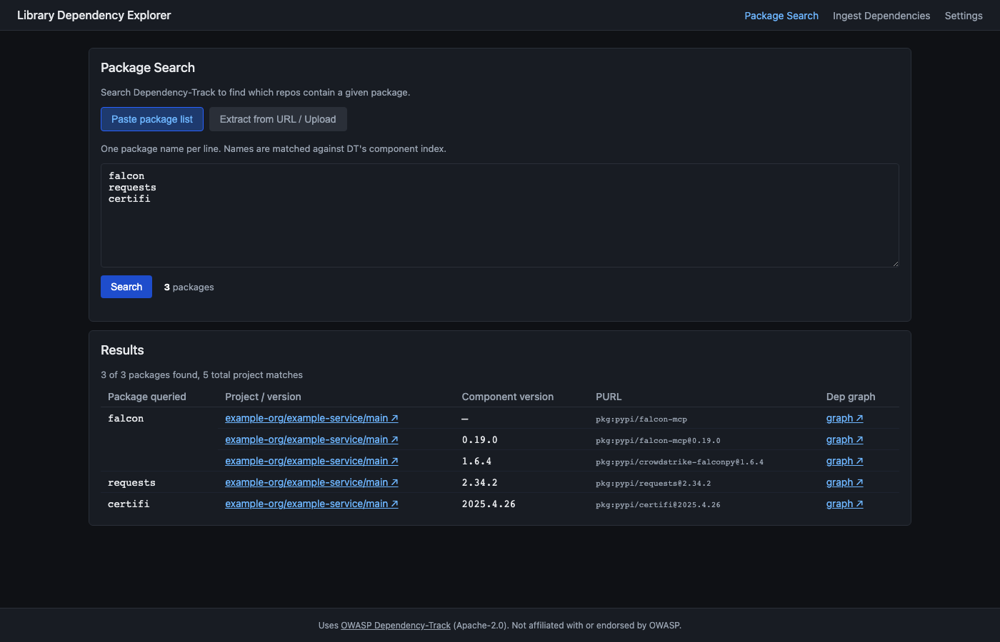
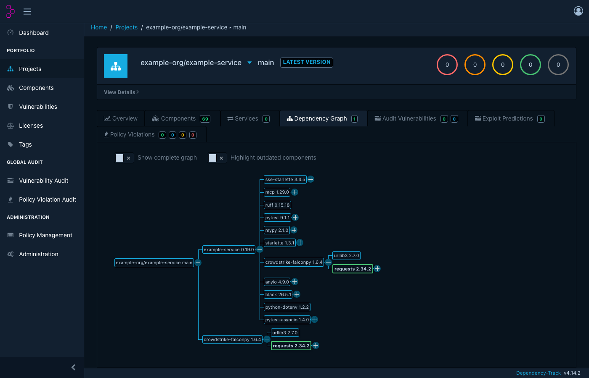
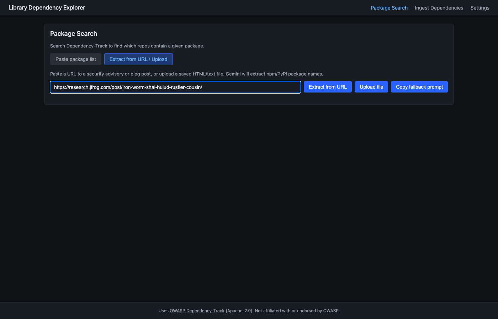
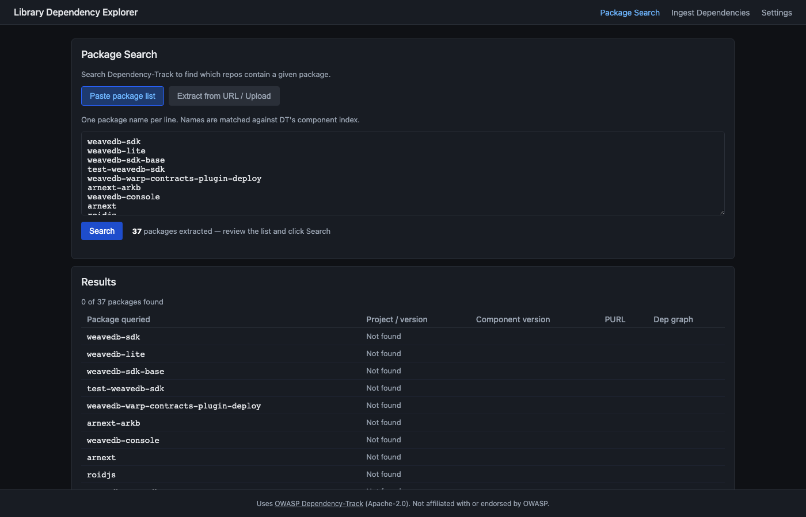
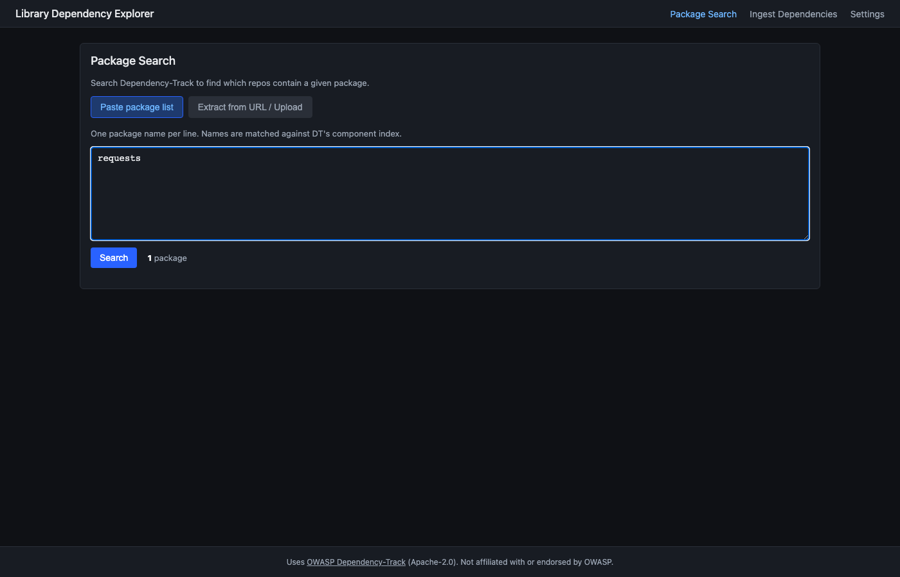

# library-dependency-explorer

A locally hosted web app that indexes every direct and transitive dependency across your GitHub organizations — without cloning a single repository.

It calls GitHub's Dependency Graph API (`/repos/{org}/{repo}/dependency-graph/sbom`), converts the SPDX 2.3 response to CycloneDX 1.4, and ingests it into [OWASP Dependency-Track](https://dependencytrack.org/). Ingest needs no Docker and no sandbox. A full org scan completes in 2–5 minutes. Repos with the Dependency Graph disabled are marked `skipped`. An earlier local pipeline is deprecated: see [ORT pipeline (deprecated)](docs/decisions.md#2-ort-pipeline-deprecated).

A **Package Search** feature lets you paste a newline-delimited list of npm or PyPI package names (or extract them from a security advisory URL or uploaded file via Gemini) and immediately see which of your repos contain those packages — with direct deep links into Dependency-Track. This is the default landing page when the app opens.

A run can pin one branch for every repo via the Branch field on Ingest
Dependencies. With that box left on default, every repo uses its GitHub
default branch.

The accompanying [`pkg-search.sh`](docs/pkg-search.md) CLI remains in the repo for ad-hoc single-package lookups.

> **See also:** [`TRD.md`](TRD.md) — the technical requirements document this implementation follows.

> **AWS login:** run `python3 scripts/set_lde_password.py` before `terraform plan`. Plan fails without `~/.lde/basic-auth.json`. The browser username is the one you typed. The browser password is the plaintext, copied to `~/.lde/lde-admin.txt`. Dependency-Track's first login is separate: run `scripts/bootstrap_dtrack.py --password-out ~/.lde/dtrack-admin.aws.txt` (AWS guide Step 5). Use that file for the Dependency-Track UI. `~/.lde/dtrack-admin.txt` is the local instance's login.

## Package Search

The **Package Search** page (default landing page) answers the question: *"Which of our repos contain this vulnerable package?"*

### Input modes

| Mode | How to use |
|---|---|
| **Paste package list** | One npm or PyPI package name per line, then click **Search**. Supports up to 500 packages per query; searches run in parallel (10 concurrent DT API calls). |
| **Extract from URL / Upload** | Paste the URL of a security advisory or blog post, or click **Upload file**. Gemini extracts affected npm/PyPI package names into the textarea for review. Requires a Gemini API key in Settings. |
| **Upload file** | Upload a saved page (`.html`, `.htm`, `.mhtml`, `.mht`, `.eml`), a `.txt` or `.md` file, or a package list as `.csv` or `.json` (max 500 KB). The same Gemini extraction runs on the file content, whatever the column layout. Use it when a page loads its package list with JavaScript, which the URL fetcher can't see. |

### Results table

Results are paginated (25 packages per page). Each row shows:

| Column | Description |
|---|---|
| **Package queried** | The name you searched for |
| **Project / version** | Clickable link to the DT project page (`/projects/{uuid}`) — fast to load |
| **Component version** | The version DT has on record |
| **PURL** | Full package URL |
| **Dep graph** | Link to the DT dependency graph view (`/projects/{uuid}/dependencyGraph/{uuid}`) — may be slow for large projects |

### Deep link configuration

Dependency-Track ships as two separate services: the **API server** (default `:8081`) and the **frontend UI** (default `:8080`). Configure both in Settings:

- **Dependency-Track API URL** (`dtrack_url`) — used for all API calls. Default: `http://localhost:8081`
- **Dependency-Track UI URL** (`dtrack_ui_url`) — used for deep links in Package Search. Default: `http://localhost:8080`

### Screenshots

**Package Search results** — `falcon`, `requests`, and `certifi` found across example-org projects:



**Pivoting into the DependencyTrack Dependency Graph** — clicking the *graph ↗* link opens the dependency graph view in [OWASP Dependency-Track](https://github.com/DependencyTrack/dependency-track), where the matched component is highlighted in the tree. This visualisation is provided entirely by Dependency-Track; Library Dependency Explorer simply constructs the deep link.



> **Credit:** The dependency graph visualisation above is rendered by [OWASP Dependency-Track](https://dependencytrack.org/) ([GitHub](https://github.com/DependencyTrack/dependency-track)), an intelligent Component Analysis platform, copyright OWASP Foundation, distributed under the [Apache License 2.0](https://github.com/DependencyTrack/dependency-track/blob/master/LICENSE.txt). Library Dependency Explorer ingests SBOMs into Dependency-Track through its API and links to its UI. It does not include or redistribute Dependency-Track, and is not affiliated with or endorsed by OWASP.

### Example: responding to a supply chain advisory

JFrog Research documented [Iron Worm](https://research.jfrog.com/post/iron-worm-shai-hulud-rustier-cousin/) — a campaign that published dozens of trojanized npm packages. Here is how to use Library Dependency Explorer to check your org's exposure in under a minute.

**1. Paste the advisory URL into "Extract from URL / Upload"**



Gemini fetches the page and extracts the affected npm package names into the textarea.

**2. Click Search — see immediately which repos are exposed**



In this case, none of the affected packages are present in the org. Every row shows "Not found" — no repos need patching for this advisory.

**3. Search for any related package — e.g. requests**



**4. Click "graph" to see where that dependency is nested**


The dependency graph (rendered by Dependency-Track) shows that `requests 2.34.2` arrives as a transitive of `crowdstrike-falconpy` inside `example-org/example-service`. This tells you exactly which repos to patch and how deeply the dependency is nested.

---

### Known limitations: Gemini URL extraction

Gemini URL extraction works well for standard advisory sites but has two failure modes:

1. **JavaScript-rendered pages** — Sites built on React/Next.js/Gatsby that don't serve pre-rendered HTML to crawlers (e.g. some boutique threat-intel blogs). The fetcher tries the Googlebot user-agent as a fallback and extracts content from `__NEXT_DATA__` / `ld+json` script blocks, but pages that are entirely client-side rendered will yield no content.

2. **Large package lists** — Advisories that list hundreds of packages (e.g. a compromised npm maintainer with 500+ packages) can exceed Gemini's output token limit even when the page content is available.

**Workaround for both cases:** copy the article text into [Gemini web](https://gemini.google.com) with the prompt *"List all affected npm and PyPI package names, one per line, no other text"*, then paste the output directly into the **Paste package list** textarea.

---

## Architecture at a glance

```
  Local web UI + orchestrator (Python stdlib) — http://localhost:8002
                          │
          gh CLI ──────── GET /repos/{org}/{repo}/dependency-graph/sbom
                          │
                          ├─ 404/403 ──────────────────────► mark skipped
                          │
                          ▼
              SPDX 2.3 → CycloneDX 1.4 conversion
              (backend/github_sbom.py)
              • packages[] → components[]
              • relationships[DEPENDS_ON] → dependencies[]
              • DESCRIBES target → metadata.component (tree root)
                          │
                          ▼
              OWASP Dependency-Track  (PUT /api/v1/bom)
```

<!-- updated: gh CLI replaced by PAT-based urllib in github_client.py / gh_auth.py -->
Each component is small, single-responsibility, and pure-stdlib Python — no Flask/FastAPI, no SDKs. All GitHub API calls use Personal Access Tokens (`github_pats` setting, one per org) read from `.settings.json` or AWS Secrets Manager — no `gh` CLI subprocess is required.

## Prerequisites

| Dependency | Required for | How to install |
|---|---|---|
<!-- updated: gh CLI no longer required; GitHub access is PAT-based (github_client.py) -->
| Python 3.11+ | The server | `brew install python@3.12` |
| GitHub PAT | Ingest | Fine-grained token — Contents: Read-only, Metadata: Read-only. Paste into Settings after starting the server. |
| Docker 24+ with Compose v2 | Running Dependency-Track locally | `brew install --cask docker` |
| `pytest` (tests only) | Testing | `pip install -r requirements.txt` |

Docker runs only Dependency-Track. Ingest itself needs only Python and a GitHub PAT.

## Quick start

> **AWS:** run `python3 scripts/set_lde_password.py` before `terraform plan`. See [the AWS guide](docs/aws-deployment.md) and [`AGENTS.md`](AGENTS.md). Local steps below do not set that secret.

> **Behind a corporate TLS-intercepting proxy (ZScaler, Netskope, Palo Alto, etc.)?**
> The `dtrack-apiserver` Docker image is built locally from `Dockerfile.dtrack`. Export your proxy's CA cert into `certs/` **before** you run `docker compose up`, then follow [Corporate proxy / TLS interception](#corporate-proxy--tls-interception) to build the images. Without a proxy, skip it: `certs/` can stay empty and the build still succeeds.

```bash
git clone <repo-url> library-dependency-explorer
cd library-dependency-explorer

# 1) Start Dependency-Track (the SBOM database)
#    Compose names the volume after this folder (<folder>_dtrack_data). A
#    second clone in a differently named folder starts an empty Dependency-Track.
docker compose up -d dtrack-apiserver dtrack-frontend
# Confirm the API is up: curl -sI http://127.0.0.1:8081/api/version

# 2) Bootstrap DT: rotate the fresh admin password, grant
#    PROJECT_CREATION_UPLOAD on the Automation team, create an API key.
#    Stock Automation already has VIEW_PORTFOLIO (used by package search).
DTRACK_ADMIN_PASSWORD=admin python3 scripts/bootstrap_dtrack.py \
  --url http://127.0.0.1:8081 --no-aws
# Writes ~/.lde/dtrack-admin.txt and ~/.lde/dtrack-api-key.txt (mode 0600).
# Prints team, permissions, key prefix and length — never the password or key.

# 3) Configure local settings
cp .settings.json.example .settings.json
# Edit .settings.json — set dtrack_api_key to the contents of ~/.lde/dtrack-api-key.txt.
# Override default_orgs to the orgs you want to scan.

# 4) Boot the local app
python3 server.py
# → Serving on http://127.0.0.1:8002
```

Open `http://localhost:8002` and head to **Runs → Start run**. Leave the orgs field blank to use your configured defaults. Ingest uses **GitHub Dependency Graph**. Use the **Repo filter** field to restrict a run to specific repos — you can use either `repo-name` (scans across all configured orgs) or `org/repo` (targets a single repo directly without scanning the full org).

## How it works

### GitHub SBOM ingest

Ingest runs in a single stage per repo, with no sandbox and no Docker.

| Stage | Module | What happens |
|---|---|---|
| `github_sbom` | [`backend/github_sbom.py`](backend/github_sbom.py) + [`backend/github_client.py`](backend/github_client.py) | For each repo, calls `gh api repos/{org}/{repo}/dependency-graph/sbom`. Repos returning 404/403 (Dependency Graph not enabled) are marked `skipped`. On 200, converts the SPDX 2.3 response to CycloneDX 1.4 and immediately ingests it into DT. Writes the BOM to `runs/{run_id}/{org}__{repo}.github_sbom.json`. |

**Why GitHub's Dependency Graph?** GitHub resolves dependencies server-side using native tooling — the result includes all transitives for every ecosystem the repo uses, resolved against the actual committed lockfiles. No sandbox or caching proxies needed. A 200-repo org scan completes in 2–5 min.

**Skipped repos:** repos with the Dependency Graph disabled (`ort_status='skipped'`) appear in the run detail table with an explanatory error. To enable the Dependency Graph on a repo: Settings → Code security and analysis → Dependency graph → Enable.

### SBOM format: SPDX 2.3 → CycloneDX 1.4

GitHub's API returns [SPDX 2.3](https://spdx.dev/use/specifications/) JSON. Dependency-Track requires [CycloneDX](https://cyclonedx.org/specification/overview/) — `backend/github_sbom.py` converts between the two using only Python stdlib.

| SPDX 2.3 field | CycloneDX 1.4 field | Notes |
|---|---|---|
| `sbom.packages[]` with a `purl` `externalRef` | `components[]` | Packages with no purl (the root repo package) are placed in `metadata.component` instead |
| `sbom.relationships[].relationshipType == "DESCRIBES"` | `metadata.component.bom-ref` | Identifies the root package; DT uses this to anchor the dependency tree |
| `sbom.relationships[].relationshipType == "DEPENDS_ON"` | `dependencies[].{ref, dependsOn[]}` | Direct and transitive edges; enables DT's **Dependency Graph** view |
| `sbom.relationships[].relationshipType == "DEPENDENCY_OF"` | `dependencies[].{ref, dependsOn[]}` | Inverse of DEPENDS_ON — handled symmetrically |

Deduplication: GitHub sometimes lists the same package multiple times (monorepos with many manifests all declaring the same shared dep). Purls are deduplicated via a `seen_purls` set before components are emitted — DT rejects BOMs with duplicate component objects.

The resulting CycloneDX BOM has `specVersion: "1.4"`, a `metadata.component` with `bom-ref` and `purl` set to the repo's GitHub purl (e.g. `pkg:github/example-org/example-platform@main`), a flat `components[]` list of all resolved dependencies, and a `dependencies[]` array encoding the full dependency graph. The dependency graph is what powers DT's **Dependency Graph** tab — it will be empty if the SPDX response contained no `DEPENDS_ON` relationships.

## Run lifecycle (Stop / Continue / Restart / Retry)

Each repo's SBOM fetch is a short HTTP call, so Stop takes effect quickly between repos.

Runs are background threads spawned per click of **Start run**. The run detail page renders lifecycle controls depending on current status:

- **Stop** (visible while the run is `running`/`queued`) — calls `POST /api/runs/{id}/stop`, which sets a per-run stop event. The run stops at the next repo boundary and lands at status `stopped`.
- **Continue** (visible after a `failed` / `partial` / `stopped` run) — re-launches the run with `resume=True` and re-fetches only repos that aren't `completed`.
- **Restart from scratch** (visible on any terminal state) — clones the same `orgs_json` into a new `run_id` and starts fresh.
- **Retry failed (N)** (visible alongside Continue when ≥1 repo has `ort_status='failed'`) — resets every failed repo to `pending` (clearing per-repo error/issue fields) and resumes the same run. N is shown in the button label.
- **Retry** (per-row button, visible on any repo with `ort_status='failed'`) — resets that single repo to `pending` and resumes the run. The run page reloads automatically so polling restarts.

## Network posture

The Dependency-Track services listen on `127.0.0.1:8080` / `127.0.0.1:8081` only (loopback-bound in `docker-compose.yml`) and run on their own `dtrack-net` Docker network. The orchestrator ingests BOMs over the host port (`127.0.0.1:8081`).

## Corporate proxy / TLS interception {#corporate-proxy--tls-interception}

> **New to the project?** Complete these steps **before** running `docker compose up -d` for the first time.  The `dtrack-apiserver` image is built locally (not pulled from a registry) and must embed your proxy's CA before it can reach NVD/OSV/GitHub Advisory feeds.

If your network intercepts outbound TLS (ZScaler, Netskope, Palo Alto, etc.) the DT apiserver's JVM won't trust the proxy's CA and you'll see errors like:

```
ERROR [NistMirrorTask] Download failed: (certificate_unknown) PKIX path building failed:
  sun.security.provider.certpath.SunCertPathBuilderException:
  unable to find valid certification path to requested target
```

BOM uploads still work (they're localhost), but DT can't fetch NVD/OSV/GitHub-Advisory feeds, so vulnerability matching breaks. The fix is to extend the DT image with the proxy's root CA so the JVM truststore trusts it.

**1. Export the root CA(s) on macOS:**

```bash
security find-certificate -a -p -c Zscaler /Library/Keychains/System.keychain \
  > certs/corp-proxy-root.crt
```

Replace `Zscaler` with the relevant name for your proxy (`Netskope`, `PaloAlto`, etc.) if different. The `-a` flag captures all matching certs (root + intermediates) into a single PEM bundle.

Verify the export:

```bash
openssl x509 -in certs/corp-proxy-root.crt -noout -subject -issuer
```

**2. Rebuild the Dependency-Track image:**

```bash
# Imports the cert into the JVM truststore (for NVD/OSV/GitHub Advisory mirror fetches).
docker compose build dtrack-apiserver
docker compose up -d dtrack-apiserver dtrack-frontend
```

The `dtrack-apiserver` service in `docker-compose.yml` already builds locally. The `certs/` directory is gitignored so the exported cert never leaves your machine.

`certs/` is passed to each local build as a named build context (`additional_contexts` in `docker-compose.yml`), not as part of the main context. Each Dockerfile bind-mounts it for a single `RUN` step and copies or imports only its `*.crt` files, so any other file in `certs/` (a stray private key, for example) never reaches an image layer. `.dockerignore` still excludes `certs/` and `*.crt`, so the production app image (`Dockerfile`, used on AWS) never contains local certs. An empty `certs/` is valid: the builds import zero certs and succeed.

| Image | Where the cert lands | Mechanism |
|---|---|---|
| `Dockerfile.dtrack` | JVM truststore | `keytool -importcert` into `$JAVA_HOME/lib/security/cacerts` |

Rebuild the relevant image after every base-image version bump so the cert lands in the new layer.

## Configuration

All app config lives in `.settings.json` (gitignored). Run `cp .settings.json.example .settings.json` to bootstrap.

| Key | Type | Default | Description |
|---|---|---|---|
| `default_orgs` | `[]` of string | `[]` | Orgs scanned when the **Start run** form is left blank. |
| `github_pats` | object | `{}` | GitHub PATs, `{"<org>": "<token>"}`, one per org (Contents: Read-only, Metadata: Read-only). A `"*"` key is the token for any org without its own entry. Required in Fargate; set in Settings UI or `.settings.json`. Masked in the settings API response. |
| `dtrack_url` | string | `http://localhost:8081` | Dependency-Track API server URL. Used for all REST API calls. |
| `dtrack_ui_url` | string | `http://localhost:8080` | Dependency-Track frontend UI URL. Used to construct deep links in Package Search. Separate from `dtrack_url` because DT ships as two Docker services on different ports. |
| `dtrack_api_key` | string | `""` | DT API key (auto-masked in the settings UI). |
| `gemini_api_key` | string | `""` | Google Gemini API key. Required for URL and file-upload extraction in Package Search. Auto-masked in the settings UI. Without this key the paste-list mode still works fully. |

**GitHub authentication** uses one Personal Access Token per org, stored under `github_pats` in `.settings.json` (or the `lde/github-pat` secret in AWS Secrets Manager in Fargate). The old single `github_pat` key is no longer read. The Settings page in the UI shows a live PAT validation status via `GET /api/gh-status`.

## HTTP API

| Method | Path | Description |
|---|---|---|
| `GET`  | `/api/settings` | Returns settings with `dtrack_api_key` masked. |
| `PUT`  | `/api/settings` | Patches whitelisted keys; rejects unknown keys with 400. |
| `GET`  | `/api/gh-status` | Live GitHub PAT validation (`GET /user`) — used by the Settings page. |
| `GET`  | `/api/dtrack-status` | Validate the saved DT API key against `GET /api/v1/team/self` — used by the Settings "Test DT API key" button. Returns `{ configured, ok, team, permissions, missing_permissions, message }`. |
| `GET`  | `/api/runs` | List the 100 most recent runs. |
| `POST` | `/api/runs` | Start a new run. Body: `{ "orgs": ["..."], "repos": ["..."], "method": "github_sbom", "use_default": true, "branch": "" }`. `orgs` defaults to `default_orgs` from settings when omitted or empty. `repos` accepts plain repo names (`"bec-api"`) or `org/repo` pairs (`"example-org/bec-api"`); when all entries use the `org/repo` format, `orgs` is derived from them and no full-org listing is done. `method` is `"github_sbom"` (the default). With `use_default: true` (or empty `branch`), every repo uses its GitHub default branch. With `use_default: false` and a non-empty `branch`, that branch is used for every repo in the run. Returns `{ "run_id": "..." }`. |
| `GET`  | `/api/runs/{id}` | Run detail: status, stage, started/completed timestamps, error, method. |
| `GET`  | `/api/runs/{id}/repos` | Per-repo breakdown for a run. Each row includes `ort_package_count` (integer or null): the component count from GitHub's SBOM. |
| `POST` | `/api/runs/{id}/stop` | Signal cancellation: sets the run's stop event. |
| `POST` | `/api/runs/{id}/continue` | Resume a `failed`/`partial`/`stopped` run from where it left off. |
| `POST` | `/api/runs/{id}/restart` | Clone the run's orgs into a new `run_id` and start fresh. Returns `{ run_id }`. |
| `POST` | `/api/runs/{id}/retry-failed` | Reset all `ort_status='failed'` repos to `pending` and resume. Returns `{ run_id, reset: N }`. Requires status ∈ {`failed`, `partial`, `stopped`}. |
| `POST` | `/api/runs/{id}/repos/{org}/{repo}/retry` | Reset a single failed repo to `pending` and resume. Returns `{ run_id, org, repo }`. |
| `GET`  | `/api/runs/{id}/logs/{org}/{repo}` | Raw run log for one repo. |
| `GET`  | `/api/runs/{id}/repos/{org}/{repo}/dtrack-components` | Live DT component listing for the repo's project: `dt_component_count` plus the components themselves. Surfaces `bom_overwrite_skipped: true` when `safe_upload_bom` refused to clobber a healthy DT project with an empty BOM on this run. |
| `GET`  | `/api/runs/{id}/coverage` | Run-wide rollup: per-repo `ort_package_count` and `dtrack_component_count`, plus a per-repo `issue` string when something looks wrong, such as a refused BOM overwrite. The `summary` block totals each issue type across the run. |
| `GET`  | `/api/dtrack/search?q={text}` | Cross-project Dependency-Track component search. The query is sent to DT's Lucene index and then precision-filtered client-side so that multi-part queries like `@wordpress/scripts` return only exact matches rather than anything containing either token. Caps at 200-char input; rejects empty input with HTTP 400. |
| `POST` | `/api/dtrack/package-search` | Batch package search. Body: `{ "packages": ["name1", "name2", ...] }`. Accepts up to 500 package names (max 200 chars each). Runs all DT searches in parallel (10 workers). Returns `{ results: [{ query, matches: [{ project, project_uuid, project_version, component, component_uuid, component_version, purl, project_link, dep_graph_link }] }] }`. |
| `POST` | `/api/extract-packages` | Submit a URL or file content for Gemini-powered npm/PyPI package extraction. Accepts `{ url: "https://..." }` or `{ text: "<html>...", filename: "advisory.html" }`. Returns `{ task_id }` immediately; poll `GET /api/tasks/{id}` for completion. Result is a plain `string[]` of package names. Requires `gemini_api_key` to be configured. |
| `GET`  | `/api/tasks/{id}` | Background task status (used by long-running operations). Returns `{ status, stage, result, error }`. Terminal responses auto-consume the task. |

## Directory layout

```
library-dependency-explorer/
├── server.py                # stdlib http.server, CORS to localhost, dotfile-blocking
├── docker-compose.yml       # Dependency-Track apiserver + frontend
├── .settings.json.example   # Config template (real secrets in .settings.json, gitignored)
├── pkg-search.sh            # Ad-hoc single-package CLI (see docs/pkg-search.md)
├── TRD.md                   # Source of truth for the pipeline design
├── backend/
│   ├── github_client.py     # gh CLI wrapper with rate-limit backoff + fetch_dependency_sbom()
│   ├── github_sbom.py       # SPDX 2.3 → CycloneDX 1.4 conversion (github_sbom pipeline)
│   ├── gh_auth.py           # `gh auth status` parser
│   ├── settings.py          # .settings.json load/save with allowlist + masking
│   ├── db.py                # SQLite WAL: runs, run_repos, manifests + orphan-detection on boot
│   ├── task_queue.py        # ThreadPoolExecutor for background work
│   ├── dtrack_client.py     # Dependency-Track REST upserts via autoCreate + cross-project search
│   ├── package_extractor.py # URL/file → HTML parse → Gemini → npm/PyPI package list
│   └── pipeline.py          # End-to-end run orchestrator
├── Dockerfile.dtrack        # DT apiserver + corporate-proxy CA
├── certs/                   # Local-only PEM bundle for the corporate proxy CA (gitignored)
├── scripts/
│   ├── cleanup.sh           # Reclaim disk: wipe sandboxes, prune docker, optionally caches
│   ├── dtrack_components.py # CLI: query DT for all components across projects (table/JSON/CSV)
│   ├── qc_sample.py         # QC: sample repos/manifests, spot-check packages against DT
│   ├── reset_dtrack_admin.py # Local: reset the Dependency-Track admin password (user runs it)
│   └── start_fresh.py       # Local: start Docker + DT, clear LDE data, delete DT projects, start LDE
├── index.html, css/, js/    # Vanilla JS SPA — no framework
│   ├── js/package_search.js # Package Search view (paste list + URL/file extraction + paginated results)
├── tests/                   # pytest unit tests
└── docs/pkg-search.md       # CLI doc for the original Bash script
```

## Development

```bash
# Run unit tests
python3 -m pytest tests/ -v


# Boot the server (auto-reload on .py/.js/.html/.css changes)
python3 server.py

# Boot on a custom port without auto-reload
python3 server.py --port 8003 --no-reload

# Start the whole local stack from a clean slate (prompts before clearing)
python3 scripts/start_fresh.py
```

`scripts/start_fresh.py` starts Docker and Dependency-Track, deletes `depexplorer.db` and `runs/` (`--backup` moves them to `~/.lde/backups/` instead), deletes every Dependency-Track project, and starts the server. Pass `--keep-data` to restart without clearing. See [docs/start-fresh.md](docs/start-fresh.md).

The auto-reloader watches `*.py`, `*.html`, `*.js`, `*.css`, `*.json` and restarts the process on any change. SQLite WAL files and the `runs/` log directory are ignored.

### Inspection CLIs

For ad-hoc investigation outside the UI:

```bash
# Per-repo coverage rollup (SBOM counts, DT counts, issues)
python3 scripts/inspect_run.py --latest --coverage

# Cross-project DT search (the @tanstack regression)
python3 scripts/dtrack_search.py @tanstack
python3 scripts/dtrack_search.py react --format csv > react-projects.csv

# Whole-portfolio DT inventory (refactored to share the new dtrack_client)
python3 scripts/dtrack_components.py --filter @tanstack --format json

# QC spot-check: sample ~20% of repos, pick 3-5 packages each, verify in DT
python3 scripts/qc_sample.py --target 50 --output qc_$(date +%Y%m%d).csv
# Reproducible re-run with the same random sample
python3 scripts/qc_sample.py --target 50 --seed 42 --output qc_seed42.csv
# Include @types/* declaration packages (skipped by default)
python3 scripts/qc_sample.py --include-type-defs --output qc_with_types.csv
```

`inspect_run.py` and `dtrack_search.py` default to talking to the live server but accept `--offline` (`inspect_run.py`) or fall back to `.settings.json` when env vars aren't set.

`qc_sample.py` produces a CSV with one row per sampled package:

| Column | Meaning |
|---|---|
| `org` / `repo` / `manifest_path` | Where the package was sampled from |
| `manifest_type` | Filename of the manifest (e.g. `package.json`, `requirements.txt`) |
| `language` | `python` or `javascript` |
| `package_name` / `package_version_spec` | As declared in the manifest |
| `in_dt` | `true` when the component is present anywhere in DT (`pass` **or** `found_elsewhere`); use this column for ecosystem-level coverage metrics |
| `dtrack_result` | `pass` — found in the DT project for this repo with matching ecosystem purl; `found_elsewhere` — in DT but attributed to a different project; `fail` — not in DT at all (or only found with wrong-ecosystem purl); `error` — DT query failed |
| `dtrack_project` | DT project where the component was found (empty on `fail`/`error`) |
| `dtrack_component_version` | Version DT has on record for the component |

A `fail` indicates either a pipeline gap (GitHub's SBOM didn't include the dep, or ingest didn't complete) or a legitimate absence (devDependency not included in the CycloneDX report). `found_elsewhere` most commonly means the dep is shared across repos and appeared first in a different project's pipeline run.

`@types/*` TypeScript declaration packages are excluded from sampling by default (they are intentionally omitted from SBOMs — no runtime code, no CVE surface). Pass `--include-type-defs` to sample them.

The purl-based ecosystem filter prevents cross-ecosystem false passes, e.g. a Maven artifact named `react-dom` cannot satisfy an npm lookup.

## Operations

### Server reload

Background pipeline threads are `daemon=True` and die instantly when the Python process restarts. The auto-reloader watches source files and `os.execv()`s on change, which kills any in-flight pipeline thread. For runs that take more than a few minutes:

```bash
python3 server.py --debug --no-reload
```

Then *don't edit source files* while a run is running.

### Orphan detection on startup

If a run was active when the server got killed (Ctrl-C, OOM, auto-reload, crash), `backend/db.py::mark_orphaned_runs()` runs at the next server boot and flips any row with status ∈ {`running`, `queued`, `resume`} to `failed/orphaned` with a clear error message. This makes the Continue button appear in the UI for that run.

### Recovering from orphaned runs

1. Click **Continue** on the orphaned run in the UI.
2. Smart-resume skips repos with `ort_status='completed'` and re-fetches the rest.

To start over instead, use **Restart from scratch**, which clones `orgs_json` into a new `run_id`.

### Verification (end-to-end smoke test)

1. `docker compose up -d dtrack-apiserver dtrack-frontend` — confirm DT is up: `curl -sI http://localhost:8081/api/version`
2. `gh auth status` — confirm logged in and any SSO orgs authorized.
3. `python3 server.py` — server starts on http://127.0.0.1:8002.
4. Start a single-repo run:
   ```bash
   RID=$(curl -s -X POST http://localhost:8002/api/runs \
     -H 'Content-Type: application/json' \
     -d '{"repos":["example-org/example-platform"],"method":"github_sbom"}' | jq -r .run_id)
   watch -n2 "curl -s http://localhost:8002/api/runs/$RID/repos | jq -r '.[] | \"\(.org)/\(.repo)  \(.ort_status)  pkgs=\(.ort_package_count//-1)\"'"
   ```
5. Confirm `runs/{run_id}/{org}__{repo}.github_sbom.json` exists and contains `"bomFormat": "CycloneDX"`, a `components` array, and a `dependencies` array.
6. In Dependency-Track, open the project → **Dependency Graph** tab — should show a populated tree. If the tab shows `[0]`, the SPDX response had no `DEPENDS_ON` relationships (repo may have the Dependency Graph only partially configured).

## Surfacing data-quality issues in the UI

The pipeline produces several quality signals beyond pass/fail. The run detail page surfaces these directly so you don't have to grep logs:

- **`0 packages` badge** when a repo's SBOM had zero packages. Indicates an empty BOM was uploaded.
- **Coverage column** compares the DT component count with the SBOM package count. Renders as `ok` when DT ≥ 75% of the SBOM count, `warn` below that, and `fail` when the SBOM has packages but DT shows 0 (DT ingest probably failed silently).
- **`overwrite refused` badge** when `safe_upload_bom`'s empty-BOM guard prevented this run from clobbering a healthy DT project. The prior project's components are still intact; re-run with `LDE_FORCE_BOM_OVERWRITE=1` if the empty result is correct.
- **Per-repo drawer** — clicking a repo row opens a live DT components table for the repo's project (paginated; first 200 components shown).

The same data is available headless via `python3 scripts/inspect_run.py --latest --coverage` and via the JSON-typed endpoints documented in the **HTTP API** table above.

### Documented but not yet built

These are the next layer of UI surfacing — the data is already exposed by the new APIs:

| Idea | Endpoint it uses | Why |
|---|---|---|
| Run-level "Coverage report" page | `GET /api/runs/{id}/coverage` | Single rollup of every per-repo data-quality issue across the run, with totals. Lets ops eyeball a run in 5 seconds. |
| Top-level `/dtrack-search` page | `GET /api/dtrack/search?q=` | Cross-project search (e.g. find every repo using `lodash` or `@tanstack/*`) with project-grouped results. |
| Run-page regression banner | `safe_upload_bom`'s `regression_warning` | When any repo dropped >50% of its DT components but the upload was permitted, show a one-line banner at the top of the run page: "N repo(s) had DT components drop >50% — review before considering this run authoritative." |
| Trend column | `dtrack_component_count` on consecutive runs of same repo | Sparkline / Δ vs prior run, so churn is visible at a glance. |

## Out of scope (today)

<!-- updated: Basic Auth is implemented; removed stale "no auth" bullet -->
- Scheduled/cron runs — trigger manually from the UI.
- Vulnerability remediation workflow — Dependency-Track owns this.
- Dependency resolution beyond what GitHub's Dependency Graph reports.

## Contributing

Contributions are welcome. See [`CONTRIBUTING.md`](CONTRIBUTING.md) for setup,
testing, and PR conventions, and [`CODE_OF_CONDUCT.md`](CODE_OF_CONDUCT.md) for
community expectations. To report a security issue, follow
[`SECURITY.md`](SECURITY.md) — please do not open a public issue.

## License

Licensed under the [Apache License 2.0](LICENSE). See [`NOTICE`](NOTICE) for
attribution.

Library Dependency Explorer works with [OWASP Dependency-Track](https://dependencytrack.org/), a separate project, copyright OWASP Foundation, under the Apache License 2.0. Dependency-Track is not included in this repository; the Docker Compose file and Terraform pull its official images.
