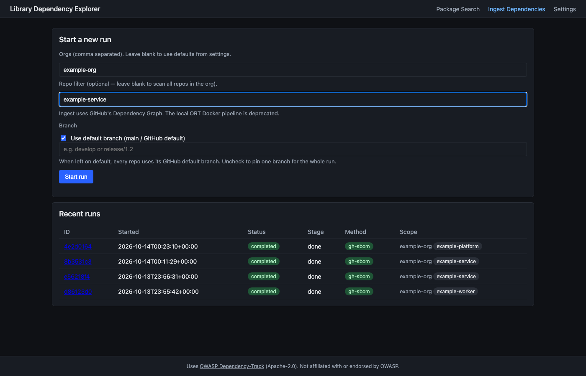
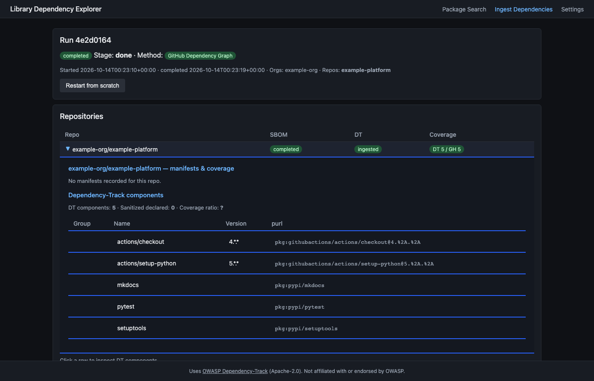

# Using Library Dependency Explorer

The core question LDE answers: **"A security advisory just dropped — which of our repos are affected?"**

This page walks through the full Package Search workflow using a real supply chain incident as the example.

---

## Quick workflow

1. Open the app at `https://lde.example.com` (or `http://localhost:8002` in local dev).
2. Go to **Ingest Dependencies** — enter an org name and click **Start run** to index your repos (GitHub Dependency Graph method, no Docker needed).
3. Once a run is complete, go to **Package Search** (the default landing page).
4. Paste a list of package names **or** paste the URL of a security advisory — Gemini extracts the package names automatically.
5. Click **Search** — results show which repos contain each package, with direct links into Dependency-Track.
6. Click **graph** on any result to see where the dependency sits in the full transitive tree.

---

## Ingesting dependencies

Before you can search, your repos need to be indexed. Go to **Ingest Dependencies** and enter the org name and an optional repo filter. Ingest always uses GitHub's Dependency Graph.

**Starting a run** — enter an org and optionally a single repo name to scope the scan:

Leave the repo filter blank to scan the entire org. Ingest always uses **GitHub Dependency Graph** — no Docker required, a full org scan completes in 2–5 minutes. Recent runs are listed below the form with their status, stage, method, and scope at a glance.

**Run detail** — after a run completes, click the run ID to inspect per-repo results:

The **Coverage** column shows `DT N / GH N` — the number of components Dependency-Track has on record versus what GitHub's Dependency Graph reported. A match means the full SBOM ingested cleanly. Expanding a repo row shows the full component list with PURLs and a live DT coverage ratio.

---

## Example: Iron Worm npm campaign

JFrog Research documented [Iron Worm](https://research.jfrog.com/post/iron-worm-shai-hulud-rustier-cousin/), a campaign that published dozens of trojanized npm packages.

Full advisory: <https://research.jfrog.com/post/iron-worm-shai-hulud-rustier-cousin/>

### Step 1 — Paste the advisory URL into "Extract from URL / Upload"

Switch to the **Extract from URL / Upload** tab, paste the advisory URL, and click **Extract from URL**. Gemini fetches the page and extracts the affected package names into the textarea automatically.

### Step 2 — Click Search — see immediately which repos are exposed

In this case, none of the affected packages are present in the org. Every row shows "Not found" — no repos need patching for this advisory. If any packages were found, each row would show the matching project with a direct link to the Dependency-Track project page and dependency graph.

### Step 3 — Search for any related package — e.g. requests

You can also type package names directly into the textarea. Enter one package per line, then click **Search**.

### Step 4 — Click "graph" to see where that dependency is nested

The dependency graph (rendered by Dependency-Track) shows that `requests 2.34.2` arrives as a transitive of `crowdstrike-falconpy` inside `example-org/example-service`. This tells you exactly which repos to patch and how deeply the dependency is nested.

---

## Input modes

| Mode | How to use |
|---|---|
| **Paste package list** | One npm or PyPI package name per line, then click **Search**. Supports up to 500 packages per query. |
| **Extract from URL / Upload** | Paste the URL of a security advisory or blog post, or click **Upload file**. Gemini extracts affected package names into the textarea for review. Requires a Gemini API key in Settings. |
| **Upload file** | Click **Upload file** and pick a saved page (`.html`, `.htm`, `.mhtml`, `.mht`, `.eml`), a `.txt` or `.md` file, or a package list exported as `.csv` or `.json`. Gemini reads any column layout and lists each package once, even when several versions are affected. Maximum 500 KB. Use this when a page loads its package list with JavaScript, as Socket's advisories do: the URL fetcher only sees the HTML the server sends, so save the page from your browser and upload it. |
| **Copy fallback prompt** | Copies a Gemini prompt you can run outside LDE. A "Clipboard unavailable" box appears only if the browser blocks clipboard write. |

---

## Reading the results table

| Column | Description |
|---|---|
| **Package queried** | The name you searched for |
| **Project / version** | Clickable link to the Dependency-Track project page — fast to load |
| **Component version** | The version DT has on record |
| **PURL** | Full package URL |
| **Dep graph** | Link to the DT dependency graph view — shows the full transitive tree with the matched component highlighted |

Results are paginated at 25 packages per page. Packages not found in any repo show "Not found" — this is a fast negative confirmation that your org is not exposed.

---

## Tips

- **If URL extraction returns no packages** — the page may be JavaScript-rendered. Copy the article text into [Gemini web](https://gemini.google.com) with the prompt *"List all affected npm and PyPI package names, one per line, no other text"*, then paste the output directly into the **Paste package list** textarea.
- **Gemini API key not configured** — URL and file extraction are disabled; the paste-list mode still works fully. Add `gemini_api_key` in Settings.
- **"Not found" means not indexed** — if a repo was never ingested, it won't appear. Run an ingest first via **Ingest Dependencies**.
